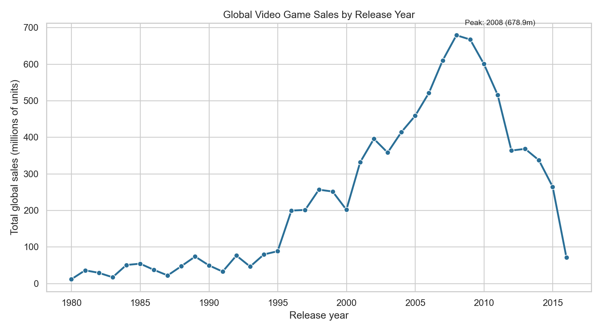
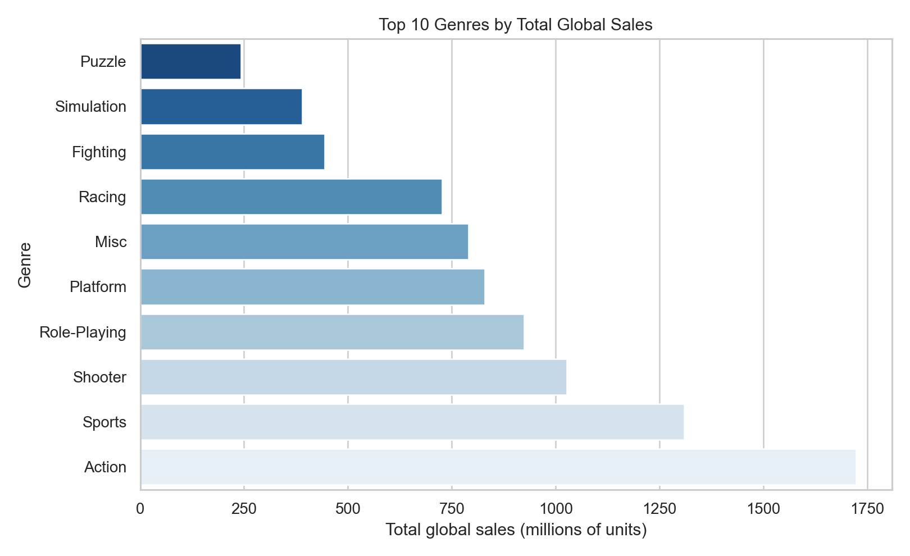
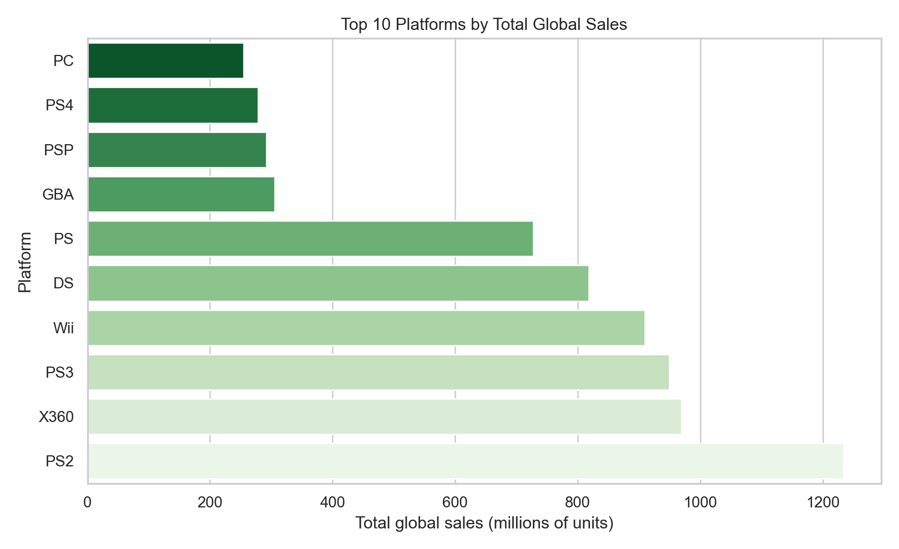

# Video Game Sales Analysis and Prediction

A reproducible end-to-end data science project that explores global video game
sales and predicts `Global_Sales` from information available at a game's release.

The workflow covers data auditing and cleaning, exploratory data analysis,
leakage-safe preprocessing, and a comparison of three regression models: a mean
baseline, ordinary linear regression, and random forest regression.

## Research question

> How well can platform, release year, genre, and publisher predict a game's
> global sales, and what does a simple, reproducible modelling workflow reveal
> about the limits of that prediction?

## Key findings

| Question | Result |
|---|---|
| When did reported global sales peak? | 2008, with 678.9 million units |
| Which genre has the highest total sales? | Action, with 1,722.83 million units |
| Which platform has the highest total sales? | PS2, with 1,233.46 million units |
| Which model performed best? | Random forest, with MAE 0.468 and R2 0.077 |
| Most useful original feature? | Publisher, by test-set permutation importance |

The low R2 is an important result rather than a defect to hide. Most games sell
very few copies while a small number become blockbusters, and basic release
metadata does not contain enough information to identify those rare successes
reliably.

## Exploratory analysis

### Global sales by release year



Reported sales grew strongly from the late 1990s and peaked in 2008. The decline
in the final years partly reflects the coverage limits of this historical
dataset, so it should not be read as a complete real-world market decline.

### Genres by total global sales



Action, Sports, and Shooter are the three largest genres by cumulative sales.
This view describes market volume, not the average performance of a single game.

### Platforms by total global sales



PS2 has the largest cumulative total, followed by Xbox 360 and PS3. Platform
totals depend on install base, release timing, and the number of games, so they
are not a direct ranking of platform quality.

## Dataset

Source: [Video Game Sales on Kaggle](https://www.kaggle.com/datasets/gregorut/videogamesales).

The raw file contains 16,598 rows and 11 columns. The audit found:

- 271 missing years.
- 58 missing publishers.
- No duplicate rows.
- 31 platforms, 12 genres, and 578 publishers.
- A maximum difference of 0.02 million units between `Global_Sales` and the sum
  of the four regional sales columns.

After dropping rows without the required modelling fields and restricting release
years to 1980-2016, the model uses 16,287 rows.

## Preventing data leakage

`Global_Sales` is closely related to the regional sales columns, so the following
fields are excluded from every predictive model:

- `Rank`
- `NA_Sales`
- `EU_Sales`
- `JP_Sales`
- `Other_Sales`
- `Name`

The predictors are `Platform`, `Year`, `Genre`, and `Publisher`. All imputers,
encoders, and scalers are fitted inside a scikit-learn Pipeline on the training
split only, and unknown categories are ignored during prediction.

## Model comparison

The target has a long right tail, so the linear regression and random forest
models train on `log1p(Global_Sales)` and convert predictions back with `expm1`
before evaluation on the original sales scale.

| Model | MAE | RMSE | R2 |
|---|---:|---:|---:|
| Mean baseline | 0.619 | 2.068 | -0.000 |
| Linear regression | 0.475 | 2.008 | 0.057 |
| Random forest | **0.468** | **1.986** | **0.077** |

Lower MAE and RMSE are better; higher R2 is better. Both learned models improve
slightly on the constant mean baseline.

## Feature importance

Permutation importance on the test set, measured as the increase in mean absolute
error when a feature is shuffled:

| Feature | Importance (mean) |
|---|---:|
| Publisher | 0.096 |
| Genre | 0.025 |
| Year | 0.024 |
| Platform | 0.021 |

Publisher is the most informative of the four release attributes for this fitted
model. These values describe this model on this data, not a causal market effect.

## Project structure

```text
game-sales-analysis/
├── data/
│   ├── raw/vgsales.csv
│   └── README.md
├── models/
│   └── README.md
├── reports/
│   ├── figures/
│   ├── tables/feature_importance.csv
│   ├── data_audit.json
│   ├── data_cleaning.json
│   ├── eda_summary.json
│   └── metrics.json
├── src/
│   ├── config.py
│   ├── data_loader.py
│   ├── preprocessing.py
│   ├── modeling.py
│   ├── eda.py
│   ├── train.py
│   ├── predict.py
│   └── main.py
├── tests/test_pipeline.py
├── pytest.ini
├── requirements.txt
└── README.md
```

The trained model file `models/random_forest_log_target.joblib` is generated
locally by the pipeline and is not committed to the repository.

## Reproduce the project

From the project root on Windows:

```powershell
py -m venv .venv
.\.venv\Scripts\python.exe -m pip install -r requirements.txt
.\.venv\Scripts\python.exe -m src.main
```

Run the tests:

```powershell
.\.venv\Scripts\python.exe -m pytest -q
```

Predict one game configuration:

```powershell
.\.venv\Scripts\python.exe -m src.predict `
  --platform PS3 `
  --genre Action `
  --publisher Activision `
  --year 2010
```

Example output:

```text
predicted_global_sales_millions: 0.325
```

The prediction is illustrative and should not be used for commercial decisions.

## Limitations

- Only records with release years in 1980-2016 are used, and the later years
  have limited coverage of digital and modern distribution channels.
- Publisher has many categories; rare publishers are grouped by frequency.
- A random 80/20 split measures general predictive behaviour, not future
  performance.
- The model uses four basic release attributes and omits marketing, budget,
  franchise strength, reviews, and user engagement.
- Feature importance describes the fitted model, not a causal market effect.
